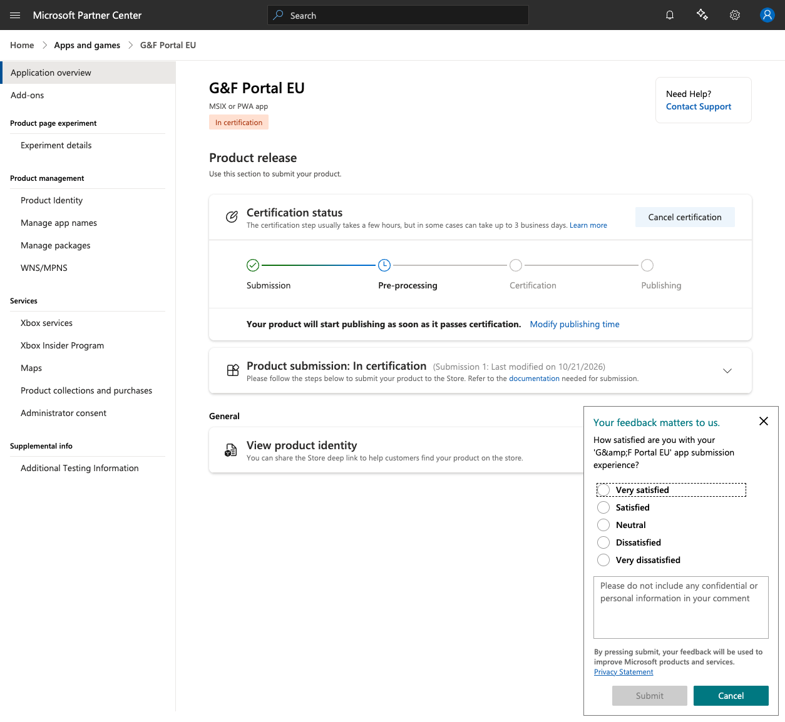

# Microsoft Store

The **G&F Portal EU** Windows desktop app is the same Electron build as the NSIS/portable installers on [GitHub Releases](https://github.com/GF-Elektro/Portal-App/releases). The Microsoft Store listing wraps that build as **AppX/MSIX** (`npm run build:win:store`, electron-builder `appx` target). Microsoft re-signs Store packages after Partner Center certification.

Do **not** Authenticode-sign `.appx` / `.msix` / `.appxupload` with Azure Artifact Signing. That path is only for GitHub `Setup.exe` / portable `.exe` ([windows-signing.md](windows-signing.md)). Store identity (`CN=A13AD157-…`) is not the Azure signing subject (`CN=G&F Elektro s. r. o.`).

**Public docs:** [microsoft-store.html](https://docs.gfelektro.com/microsoft-store.html)

**Partner Center product:** [G&F Portal EU](https://partner.microsoft.com/en-us/dashboard/products/9MXWQW7F7XPT/overview) (MSIX or PWA app). Store listing: [apps.microsoft.com/detail/9MXWQW7F7XPT](https://apps.microsoft.com/detail/9MXWQW7F7XPT).

## Status (2026-10-21)

Submission 1 is **in certification** (package `GFElektroPortal-1.0.65.appx`, Desktop x64). Confirmation:



GitHub/docs.gfelektro.com Windows downloads stay NSIS/portable until the listing is published. Do not start a second Store submission unless certification fails or a new package is required.

## Maintainer runbook

### Build locally (Windows)

```powershell
npm run build:win:store
# electron-builder --win appx --publish never --config.win.executableName=GFPortalEU
# Output: release/GFElektroPortal-<version>.appx  (and .appxupload if created)
```

`executableName=GFPortalEU` is required: `productName` contains `&` (`G&F Portal EU`) and MakeAppx rejects an unescaped ampersand in the exe name.

Optional smoke (unsigned package needs Developer Mode):

```powershell
Add-AppxPackage -Path .\release\*.appx
Get-AppxPackage | Where-Object { $_.Name -like "*GFPortalEU*" }
```

Keep `npm run build:win` for signed NSIS/portable. Never run `azure/artifact-signing-action` on Store artifacts. Unset `CSC_LINK` for Store builds so electron-builder uses the Partner Center publisher placeholder until Microsoft re-signs.

There is no in-app updater on this channel; Store owns updates. Do not add `electron-updater` for Store packages.

### CI

On each `v*` tag, **Build Windows Store AppX** in [`.github/workflows/release.yml`](../.github/workflows/release.yml) (`windows-latest`):

1. `npx electron-builder build --win appx --publish never --config.win.executableName=GFPortalEU`
2. Uploads `release/*.appx` / `release/*.appxupload` as artifact `GFElektroPortal-appx`
3. Attaches those files to the GitHub Release (not as the user-facing installer)

Azure signing env is not applied to this job. Download with `gh release download vX.Y.Z --pattern '*.appx'`.

### Partner Center upload (when a new Store package is required)

1. Use the already-logged-in Partner Center tab (product `9MXWQW7F7XPT`).
2. New submission → Packages: upload `.appx` or `.appxupload`. Desktop only (Windows 10/11 Desktop). Do not check Xbox / HoloLens / Mobile.
3. Restricted capability `runFullTrust` (max 500 characters on Submission options): Electron Win32 shell needs full trust for tray, BrowserWindow (auth popups), native notifications (`com.gfelektro.portal`), and camera/mic. Hosted content is only `https://portal.gfelektro.com`.
4. Listing copy and screenshots: sections below. EN/DE/SK plus package languages (cs, hu, pl, uk) were filled on Submission 1.
5. Click **Submit for certification**. Do not change payout/purchase settings.

## Reserved package identity

Copied from Partner Center → Product identity after reserving the name **G&F Portal EU**. These values are locked for this Store product.

| Manifest field | Value |
| --- | --- |
| Package/Identity/Name | `GFElektro.GFPortalEU` |
| Package/Identity/Publisher | `CN=A13AD157-0238-4037-901B-C007A13489C7` |
| Package/Properties/PublisherDisplayName | `G&F Elektro` |
| Package Family Name (PFN) | `GFElektro.GFPortalEU_bmafrkax0y7g8` |
| Store ID | `9MXWQW7F7XPT` |
| Store protocol | `ms-windows-store://pdp/?productid=9MXWQW7F7XPT` |

Do **not** upload Apple signing files (`.p12`, `.p8`, provisioning profiles) to Microsoft Partner Center.

Tile assets live in `build/appx/` (`StoreLogo.png`, `Square44x44Logo.png`, `Square150x150Logo.png`, `Wide310x150Logo.png`).

## Permissions

The Store package must declare the same capabilities the Electron app already uses (`build.appx.capabilities` in `package.json`):

| Capability | Purpose |
| --- | --- |
| `internetClient` | Load `https://portal.gfelektro.com` |
| `microphone` | Dictation and audio in the portal |
| `webcam` | Site photos and camera capture |
| `location` (optional) | GPS in daily reports when enabled in the portal |
| `runFullTrust` | Required for Electron (always added by electron-builder) |

## Store listing (Partner Center)

The listing must say this is the official G&F Elektro employee client, not a generic browser.

- **Privacy policy:** https://docs.gfelektro.com/permissions.html
- **Category:** Business / Collaboration
- **Price:** Free
- **Markets:** SK, DE, CZ, PL, HU, AT, and other markets already served (Submission 1: worldwide / 240 markets)
- **Device family:** Desktop only (not Xbox / HoloLens)

**Short description (EN, ≤300):** Official Windows desktop client for the G&F Elektro employee portal. Tray, notifications, and in-app Google sign-in — not a generic browser.

**Short description (DE):** Offizieller Windows-Desktop-Client für das G&F-Elektro-Mitarbeiterportal. Infobereich, Benachrichtigungen und Google-Anmeldung in der App.

**Short description (SK):** Oficiálny Windows desktopový klient zamestnaneckého portálu G&F Elektro. Lišta, oznámenia a prihlásenie Google v aplikácii.

**Description (EN):** G&F Portal EU is the official Windows desktop client for G&F Elektro’s employee portal at https://portal.gfelektro.com. It is not a generic web browser. The native shell keeps the portal in the system tray, shows Windows notifications, opens Google/Firebase sign-in inside the app, and requests camera, microphone, and optional location for site photos, dictation, and daily reports.

**Description (DE):** G&F Portal EU ist der offizielle Windows-Desktop-Client für das Mitarbeiterportal von G&F Elektro unter https://portal.gfelektro.com. Es ist kein generischer Webbrowser. Die native Hülle hält das Portal im Infobereich, zeigt Windows-Benachrichtigungen, öffnet Google-/Firebase-Anmeldung in der App und fragt Kamera, Mikrofon und optional Standort für Baustellenfotos, Diktat und Tagesberichte.

**Description (SK):** G&F Portal EU je oficiálny Windows desktopový klient zamestnaneckého portálu G&F Elektro na https://portal.gfelektro.com. Nie je to všeobecný webový prehliadač. Natívny shell drží portál v systémovej lište, zobrazuje oznámenia Windows, otvára prihlásenie Google/Firebase v aplikácii a žiada kameru, mikrofón a voliteľne polohu pre fotky z stavby, diktát a denné správy.

**Website:** https://www.gfelektro.com  
**Support contact:** info@gfelektro.com  
**Age rating:** IARC 3+ / PEGI 3 / ESRB Everyone (business tool, online content without ratings-relevant material). Account required. No public UGC, no ads, no in-app purchases.

### Screenshots (Desktop, 1920×1080)

Partner Center requires at least one Desktop screenshot ≥1366×768. Use these PNGs (portal UI as shown in the desktop client):

| File | Caption (EN) |
| --- | --- |
| [`docs/assets/store/01-dashboard.png`](assets/store/01-dashboard.png) | Site-supervisor dashboard — timesheets, extras, and weekly control |
| [`docs/assets/store/02-news.png`](assets/store/02-news.png) | Company news and required updates in the employee portal |
| [`docs/assets/store/03-ideas.png`](assets/store/03-ideas.png) | Submit site ideas with photos, voice, and optional AI assist |
| [`docs/assets/store/04-hours.png`](assets/store/04-hours.png) | Digital timesheet — report hours and send the weekly sheet |

Do not upload screenshots that show personal email addresses, home interiors, or street addresses.

### Restricted capability `runFullTrust`

Electron’s desktop shell needs full trust for the tray, BrowserWindow (including auth popups), native notifications, and camera/microphone access. The hosted portal stays at https://portal.gfelektro.com. Partner Center Submission options field is **max 500 characters**.

### Notes for certification

Camera, microphone, and location are used only inside the hosted portal. Location is optional (daily reports). Closing the window hides to the tray by design. A G&F Portal account is required. Testers: Google/Firebase sign-in uses the in-app popup; do not force-close it.

## Today

Users still install Windows builds from the [docs download page](https://docs.gfelektro.com) or GitHub Releases until Microsoft publishes the listing. Camera and microphone prompts are handled in [`src/main.js`](../src/main.js) (including Windows privacy settings links when access is denied).
